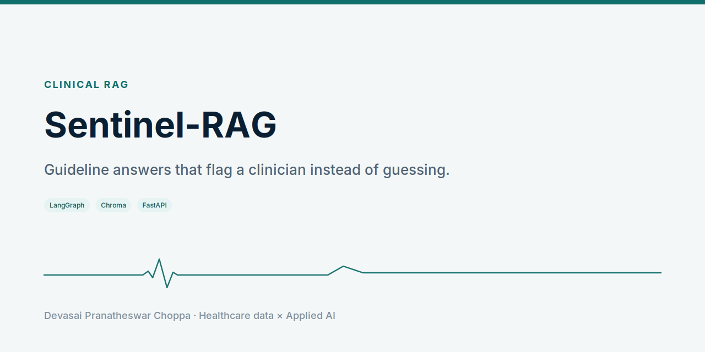
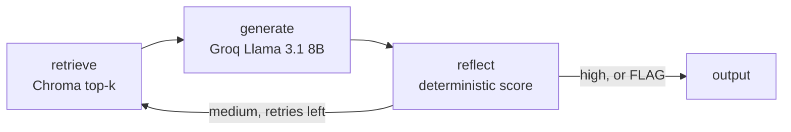

<picture>
  <source media="(prefers-color-scheme: dark)" srcset="docs/social-preview-dark.png">
  
</picture>

**Guideline-grounded answers that refuse to be confidently wrong.**

<p align="center">
  
</p>

Research prototype. Not a medical device. The bundled corpus is a fictional diabetes guideline.

## Problem

A fluent wrong answer about a dose, a contraindication, or a first-line step is a patient-safety event. Ordinary RAG returns the first draft.

## Solution

Sentinel-RAG answers only from guidelines the operator ingested. It scores the draft in code, then returns it, retries with a wider retrieval, or marks it FLAG for a clinician.

## Architecture



Four LangGraph nodes, compiled in `sentinel-rag/src/agent.py`: `retrieve`, `generate`, `reflect`, `output`. FLAG is a decision on `reflect`, written by `output`.

## Tech stack

Python, LangGraph, LangChain, Chroma, sentence-transformers, Groq, FastAPI, Streamlit, Next.js landing, Docker, SQLAlchemy.

## Quickstart

From `sentinel-rag/`:

```bash
cp .env.example .env
pip install -r requirements.txt
uvicorn src.api.main:app --reload --port 8000
streamlit run app.py
```

Set `GROQ_API_KEY` for live answers. The landing page:

```bash
cd landing && npm install && npm run dev
```

Docker: `docker compose up --build` from `sentinel-rag/`. UI on port 8501, API on port 8000.

## Results

No accuracy figure is published here. The product README states that no accuracy number is asserted until it is measured. What the graph does is inspectable in tests: a draft with no grounding is flagged.

## Roadmap

The open product notes live in `sentinel-rag/docs/`. Live multi-tenant clinic deployment is not claimed.

## License

MIT. The license file is `sentinel-rag/LICENSE`.
